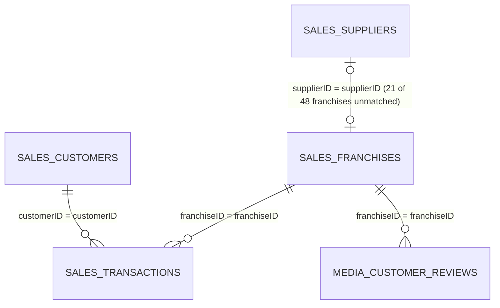

# Data Model Summary — bakehouse_sales

Written by build session 04 (wave 1). All figures are exact (every table is under the 10M-row sampling threshold). Read-only SQL only.

## Tables
| table | rows | grain | primary_key | role | profile |
|---|---|---|---|---|---|
| samples.bakehouse.sales_transactions | 3333 | one row per sales transaction (one product line) | transactionID | fact | [sales_transactions](sales_transactions.md) |
| samples.bakehouse.media_customer_reviews | 204 | one row per customer review of a franchise | new_id | fact | [media_customer_reviews](media_customer_reviews.md) |
| samples.bakehouse.sales_customers | 300 | one row per customer | customerID | dimension | [sales_customers](sales_customers.md) |
| samples.bakehouse.sales_franchises | 48 | one row per franchise location | franchiseID | dimension | [sales_franchises](sales_franchises.md) |
| samples.bakehouse.sales_suppliers | 27 | one row per ingredient supplier | supplierID | dimension | [sales_suppliers](sales_suppliers.md) |

Star schema: `sales_transactions` is the central fact (additive `quantity`, `totalPrice`; many-to-one joins to customers and franchises). `media_customer_reviews` is a second, measure-less fact (count of rows) attached to franchises only. `sales_suppliers` is an outrigger of `sales_franchises` (snowflake). No declared PK/FK constraints exist on any table; all keys below were verified from data.

## Entity-relationship diagram

## Joins
| left | right | keys | verified_cardinality | orphan_rate | query_used |
|---|---|---|---|---|---|
| samples.bakehouse.sales_transactions | samples.bakehouse.sales_customers | customerID = customerID | many_to_one | 0.0 | WITH l AS (SELECT customerID AS k, count(*) AS n FROM samples.bakehouse.sales_transactions GROUP BY customerID), r AS (SELECT customerID AS k, count(*) AS n FROM samples.bakehouse.sales_customers GROUP BY customerID) SELECT max(l.n) AS max_left_rows_per_key, max(r.n) AS max_right_rows_per_key, count(*) AS matched_keys FROM l JOIN r ON l.k = r.k |
| samples.bakehouse.sales_transactions | samples.bakehouse.sales_franchises | franchiseID = franchiseID | many_to_one | 0.0 | WITH l AS (SELECT franchiseID AS k, count(*) AS n FROM samples.bakehouse.sales_transactions GROUP BY franchiseID), r AS (SELECT franchiseID AS k, count(*) AS n FROM samples.bakehouse.sales_franchises GROUP BY franchiseID) SELECT max(l.n) AS max_left_rows_per_key, max(r.n) AS max_right_rows_per_key, count(*) AS matched_keys FROM l JOIN r ON l.k = r.k |
| samples.bakehouse.sales_franchises | samples.bakehouse.sales_suppliers | supplierID = supplierID | one_to_one | 0.4375 | WITH l AS (SELECT supplierID AS k, count(*) AS n FROM samples.bakehouse.sales_franchises GROUP BY supplierID), r AS (SELECT supplierID AS k, count(*) AS n FROM samples.bakehouse.sales_suppliers GROUP BY supplierID) SELECT max(l.n) AS max_left_rows_per_key, max(r.n) AS max_right_rows_per_key, count(*) AS matched_keys FROM l JOIN r ON l.k = r.k |
| samples.bakehouse.media_customer_reviews | samples.bakehouse.sales_franchises | franchiseID = franchiseID | many_to_one | 0.0 | WITH l AS (SELECT franchiseID AS k, count(*) AS n FROM samples.bakehouse.media_customer_reviews GROUP BY franchiseID), r AS (SELECT franchiseID AS k, count(*) AS n FROM samples.bakehouse.sales_franchises GROUP BY franchiseID) SELECT max(l.n) AS max_left_rows_per_key, max(r.n) AS max_right_rows_per_key, count(*) AS matched_keys FROM l JOIN r ON l.k = r.k |

Pattern G results (max_left_rows_per_key / max_right_rows_per_key / matched_keys): 22 / 1 / 300; 90 / 1 / 48; 1 / 1 / 27; 6 / 1 / 48. Orphan rates from pattern D (left rows whose key is missing on the right). Types match on every join (bigint = bigint). Every right-side key is referenced at least once (0 unreferenced customers, franchises or suppliers).

Notes for metric view synthesis:
* All right-side keys are unique (exact, full table), so `rely.at_most_one_match` is safe on all four joins.
* `sales_franchises -> sales_suppliers` is one_to_one on matched keys but 21 of 48 franchises have no supplier row. Those franchises carry 1,480 of 3,333 transactions and 33,537 of 66,471 revenue (50.5%). Use a LEFT join and an "Unknown supplier" label (requirements rule); an inner join halves revenue.
* Joins stated in the supplemental requirements document (`/Volumes/.../requirements/bakehouse_business_requirements.md`) match the four joins above exactly.
* Cross-check against the requirements expected answers (exact queries): revenue 66,471, units 22,157, transactions 3,333, revenue by franchise country Japan 21,591 / US 20,736 / Australia 8,211. All match.
* No join path exists between reviews and customers or transactions; reviews relate to sales only through franchise.

## Materialization candidates
| table_or_join | signals | suggested dimensions | note |
|---|---|---|---|
| samples.bakehouse.sales_transactions | hot_table | product, paymentMethod, day of dateTime | Core KPIs (revenue, units, transactions, AOV) live here. 3,333 rows: materialization is optional, not needed for performance. Usage history is empty, so the flag comes from KPI importance |
| sales_transactions -> sales_franchises -> sales_suppliers | multi_join | supplier name, ingredient, supplier continent | Supplier-level sales need 3 tables; LEFT join on suppliers |
| sales_transactions + media_customer_reviews via sales_franchises | fan_out | franchise country, city, size | Two facts share the franchise dimension. Keep sales and review measures in separate metric views, or pre-aggregate reviews to franchise before combining, to avoid double counting |
| sales_franchises | filter_columns | country, size, city | Franchise location is the default geography (requirements) |

No table exceeds the `large_table` threshold (largest: 3,333 rows).

## Data quality flags
| table | column | issue | impact on metric views |
|---|---|---|---|
| samples.bakehouse.sales_franchises | supplierID | 21/48 (43.75%) reference suppliers missing from sales_suppliers | LEFT join + "Unknown supplier" label; never inner join |
| samples.bakehouse.sales_transactions | unitPrice | constant 3 on all rows | Average unit price must be revenue / units (weighted); no price dimension value |
| samples.bakehouse.sales_transactions | totalPrice | equals quantity x unitPrice on all rows (0 mismatches) | Revenue = SUM(totalPrice); do not recompute |
| samples.bakehouse.sales_transactions | cardNumber | sensitive, unique per row | Exclude from dimensions and samples |
| samples.bakehouse.sales_transactions | paymentMethod | stored lower case (amex, mastercard, visa) | Display capitalisation via expression or agent instruction |
| samples.bakehouse.sales_customers | first_name, last_name, email_address, phone_number, address, postal_zip_code | PII | Exclude from dimensions (privacy rule) |
| samples.bakehouse.sales_customers | state | mixes full names and abbreviations (e.g. MS and Mississippi) | State-level counts split; avoid as dimension or normalise |
| samples.bakehouse.sales_customers / sales_franchises | country | customers use USA, franchises use US | Different vocabularies; keep franchise and customer geography as separate dimensions with clear names |
| samples.bakehouse.sales_franchises | name | 46 distinct for 48 franchises (2 names repeated) | Group by franchiseID; name is a label only |
| samples.bakehouse.sales_franchises / sales_suppliers | size | ordinal S, M, L, XL, XXL | Needs explicit sort order |
| samples.bakehouse.sales_suppliers | approved | constant Y | Approved filter is a no-op on current data |
| samples.bakehouse.media_customer_reviews | review_date | only 6 distinct timestamps; range 2024-05-20 to 05-31, no overlap with transactions (05-01 to 05-17) | Inference: batch load time, not review time. Avoid day-level review trends; a shared date filter with sales returns empty sides |
| samples.bakehouse.media_customer_reviews | review | free text, no rating column | Review count only; never expose text |

## Not available
* Declared constraints: none exist in `samples.information_schema.table_constraints` for any of the 5 tables (query ran; 0 rows).
* Lineage: `system.access.table_lineage` ran; only notebook read events, no upstream or downstream tables in the last 90 days.
* Usage: `system.query.history` ran; 0 finished queries referencing these tables in the last 30 days, so no join or filter columns could be learned from usage.
* KPI hints from `docs/research/02_kpi_definitions.md` and `docs/context/` were not yet written when this session ran (sessions 02 and 03 run in parallel). KPI and join rules were taken from the supplemental requirements document instead.
